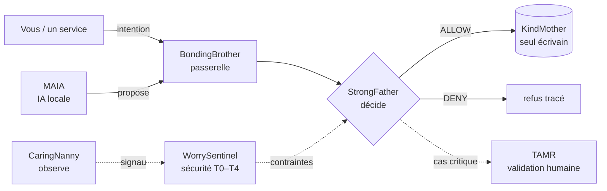
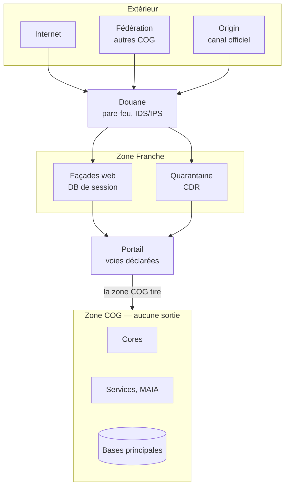
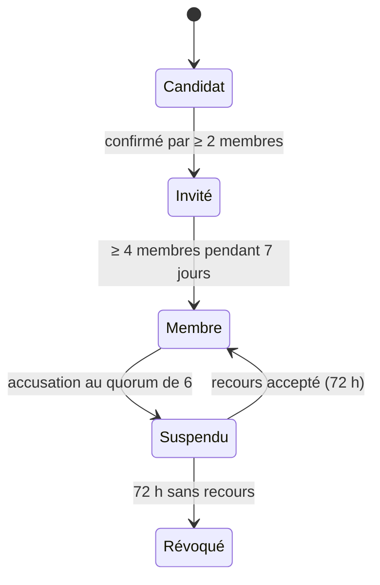

# Miyukini COG

> Votre environnement numérique souverain : vos services (agenda, comptabilité, documents, cloud, domotique, IA locale) dans un seul système qui tourne chez vous, sans abonnement cloud et sans dépendance externe. Une IA qui **propose**, des règles qui **décident**.

**Version** : 0.9.0-beta.1 (recette) · **Dernière mise à jour** : 2026-10-25

---

## En bref

- **Tout est local** : vos données restent sur votre machine, chiffrées, et tout fonctionne hors ligne.
- **Gouverné** : chaque action passe par des composants de gouvernance (les **Cores**) qui décident, persistent, surveillent et tracent. Rien n'est implicite, tout est refusé par défaut.
- **IA locale bornée** : MAIA tourne sur votre matériel ; elle ne décide jamais seule, et sa mémoire ne quitte jamais votre COG.
- **Fédérable** : plusieurs COG peuvent coopérer comme des pays souverains (passeports, visas, quorum), sans serveur central obligatoire.

---

## À qui s'adresse Miyukini ?

| Vous êtes... | Miyukini vous apporte |
|---|---|
| **Indépendant, profession réglementée** (santé, droit, expertise comptable) | Agenda, rendez-vous, comptabilité, IA locale qui ne sort pas vos données |
| **TPE, PME, association** | Calendrier partagé, contacts, documents, cloud privé, un seul serveur |
| **Particulier** | Budget, cloud privé, calendrier, domotique, assistant vocal local |
| **Équipe** | Suite bureautique souveraine (Docs, Sheets, Slides, Formulaire, Réunion, Mail, Message) |
| **Développeur curieux** | Architecture gouvernée en Rust, 134 crates, IA locale, sécurité vérifiable |

---

## Ce que Miyukini fait

| Domaine | Services |
|---|---|
| **Hub** | **Miyukini Central** — point d'entrée unique, lance et surveille chaque service |
| **Organisation** | **JayKoa** (calendrier universel), **JayRDV** (rendez-vous), **MiyukiniWatch** (métriques et habitudes) |
| **Finances** | **JayKonta** (budget, comptabilité), **MiyukiniSales** (devis, commandes, factures) |
| **Collaboratif** | **Jay Bureau** (Docs, Sheets, Slides, Formulaire, Réunion, Club, Mail, Message), **Jay1Tribu** (réseau privé) |
| **Fichiers** | **MiyuCloud** (fichiers, CalDAV, CardDAV, WebDAV, WOPI), **JayCloud** (sauvegardes et restauration) |
| **IA locale** | **MAIA** (LLM local, mémoire chiffrée, Fiches fédérées), **Miyukini Whisper** (dictée et voix locales) |
| **Domotique** | **Alicia** (assistante vocale, MQTT, automatisations) |

Au total : **30 services et applications** dans le workspace. Retirés : MGE, Allumina, Sodomight, MiyuClicker, Survivor (2026-10), JayXpose, JayFestival (2026-04).

---

## Comment c'est construit

### Le principe : l'IA propose, les règles décident



- Un service ou MAIA n'écrit jamais directement : il émet une **intention**, **StrongFather** décide (refus par défaut), **KindMother** est le **seul** à écrire, dans des bases chiffrées et avec un journal d'audit chaîné.
- Les décisions sensibles passent par une **validation humaine** encadrée (TAMR).

### Les 10 Cores

| Core | Rôle |
|---|---|
| **StrongFather** | Décide (autorise ou refuse) — n'exécute ni ne persiste |
| **KindMother** | Persiste — seul validateur des écritures, ne décide jamais |
| **BondingBrother** | Passerelle — traduit, filtre, transmet |
| **BorderGuard** | Définit les frontières et les niveaux de confiance |
| **WorrySentinel** | Gouverne la sécurité (états T0 à T4) |
| **CaringNanny** | Observe l'état, ne modifie rien |
| **MasterButler** | Registre des capacités et permissions |
| **LogisticsSteward** | Arbitre ressources et quotas |
| **EverBuddy** | Cycle de vie, historique immuable |
| **TAMR** | Cadre de l'intervention humaine, traçabilité absolue |

### Les zones : rien n'entre sans contrôle, rien ne sort de la zone COG



- **La zone COG ne sort jamais** : elle va chercher ce dont elle a besoin à travers le **Portail**, par des voies déclarées. Une sortie bloquée est un incident critique.
- **La Douane** filtre en bordure ; les **Vigies** détectent et coupent une voie en cas d'anomalie ou de capteur muet.
- **La quarantaine** désarme les fichiers entrants (CDR) avant qu'ils n'atteignent vos données.

### Identité : des signatures, pas des secrets partagés

- Chaque COG a une **racine** (clé hors ligne) ; chaque personne et chaque appareil reçoivent un **passeport**, et un **visa** pour accéder à un service.
- Tout titre est un **Sceau** signé (Ed25519, multi-signature possible) ; les révocations sont publiées dans des **registres Merkle** vérifiables.
- Les mises à jour arrivent par un **canal officiel** signé (2 signatures sur 2) ; c'est vous qui les relevez, rien n'est poussé de force.

### Fédération



- Les COG se reconnaissent entre eux ; une faute se prouve par des **preuves signées** (équivoque), jamais par simple réputation.
- La Fédération fonctionne **sans Origin** ; un COG peut aussi rester seul, sans aucun réseau.

### MAIA, l'IA locale

- Modèles locaux adaptés au matériel (des petites configurations à Strata).
- **Mémoire chiffrée par utilisateur**, classée nationale : jamais publiée, jamais synchronisée, **oubli réel** à la demande (effacement physique vérifié).
- **Fiches fédérées** : MAIA peut lire des connaissances d'autres COG, marquées étrangères, corroborées par plusieurs sources ; elle ne publie une Fiche que sur une donnée que **vous** avez étiquetée et signée.

---

## Sécurité

| Couche | Protection |
|---|---|
| **Données au repos** | SQLCipher (AES-256), une clé par base ; effacement physique des données oubliées |
| **Écritures** | KindMother seul écrivain : intentions typées, refus par défaut, journal d'audit chaîné |
| **Identité** | Passeports, visas et preuves de possession signés ; aucun secret partagé là où une signature suffit |
| **Réseau** | Zone COG sans sortie, Douane nftables générée et auditée, journaux bornés, Vigies IDS |
| **Système** | Profils AppArmor en mode enforce pour chaque service |
| **Mises à jour** | Canal officiel signé ; paquet vérifié (liste exacte, signature) avant toute installation ; retour arrière automatique |
| **Code** | Rust ; aucun `unwrap`/`panic` dans le code exposé au réseau ; fuzzing des formats binaires (13 crates) |
| **Conformité** | Référentiels visés : ANSSI (CSPN), CRA, RGPD, AI Act, OWASP ASVS — voir [conformité](docs/conformite/CONFORMITE-SYNTHESE.md) |

---

## État du projet

- **0.9.0-beta.1** : version de **recette**, à installer sur une machine dédiée, jamais en production. Procédure : [notes de version](docs/recette/NOTES-DE-VERSION-0.9.0-beta.1.md).
- **Conception gelée** : [doc conceptuelle v1](docs/architecture/GEL-DOC-CONCEPTUELLE-v1.md), modifiée seulement par amendements (21 à ce jour), écrits **avant** le code.
- **Plan** : [plan d'implémentation](docs/implementation/PLAN-IMPLEMENTATION.md) — lots 0 à 7 atteints au niveau bibliothèque ; restent notamment les vrais modèles d'IA, le transport entre COG et la séparation entrée / sortie du Portail.
- **En conception (v2)** : les [Alliances](docs/architecture/alliance/_index.md), fédérations privées d'organisations avec un centre de commandement au quorum et un annuaire « AD maison ».
- **Pas encore** : certification, audit externe, déploiement en production.

### Chiffres clés

```
 10 Cores de gouvernance
134 crates Rust · 17 applications
 30 services et applications
3857 tests automatisés (workspace)
 21 amendements à la doc gelée
```

---

## Un projet piloté par IA

Miyukini COG est conçu en **Vibe Coding** : l'auteur définit l'intention, la vision et les contraintes ; des agents IA génèrent, implémentent et revoient, sous supervision humaine. Pour tenir la cohérence à cette échelle :

| Protocole | Rôle |
|---|---|
| **Doc gelée + amendements** | Toute évolution est écrite et validée avant le code |
| **MSCM** | Balisage sémantique — chaque bloc de code porte son identité |
| **MIP** | Index structurel global, navigable par l'IA |
| **Revues de sécurité** | Chaque lot est relu ; chaque constat devient un test de non-régression |

---

## Technologies

| Composant | Technologie |
|---|---|
| Langage | **Rust** |
| Interface | **Dioxus** |
| Données | **SQLCipher** via KindMother |
| Signature | **Ed25519** (Sceau), registres Merkle |
| IA locale | **llama.cpp** (LLM), **Whisper** (STT) |
| Réseau | **nftables** (Douane), **rustls**, **WireGuard** (Fédération) |
| Cloud privé | **WebDAV / CalDAV / CardDAV / WOPI** |
| Domotique | **MQTT** + HTTP |

---

## Démarrage rapide (développement)

```bash
git clone https://github.com/StudioMiyukini/miyukini_cog.git
cd miyukini_cog
cargo build -p miyukini-central-native
cargo run -p miyukini-central-native
```

Prérequis : [Rust](https://rustup.rs/) 1.75+. Pour une installation de recette complète (services, AppArmor, zone COG), voir [deploy/recette](deploy/recette/).

---

## Licence

- **Usage personnel** (personne physique, non commercial) : **gratuit**
- **Usage professionnel** (entreprise, association, administration) : **licence commerciale requise**

Détails : [politique de licence](docs/legal/Miyukini%20-%20Politique%20de%20Licence.md)

---

> *« Miyukini n'est pas un logiciel de plus. C'est un environnement gouverné dans lequel vos services opèrent — souverainement, localement, et sous votre contrôle. »*
